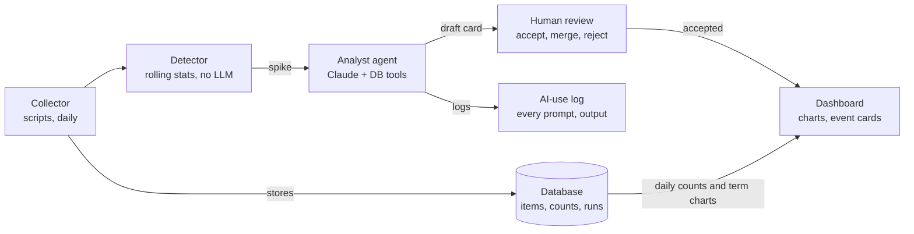

# Live agentic discourse monitor: design options

Draft, 2026-11-05. A design for discussion, not a decision.

## Purpose and scope

The product would turn the current one-off Reddit counts into a service that keeps collecting "AI" / "artificial intelligence" posts and comments, flags candidate events as they happen, and shows them on a dashboard. The supervisor suggested it as both a practical output and part of the methodological contribution.

This doc covers the system only: architecture options, tools, rough costs and decisions. It does not choose research questions, interpret findings or pick events.

What "live" means here, as a working assumption: new data pulled daily, candidate events flagged within about a day, and a dashboard that can be opened in a browser.

## Starting point

The existing pipeline already covers the first stage in batch form, so the live product extends it rather than replacing it.

| Piece | What it does today | What changes for live |
| --- | --- | --- |
| Arctic Shift API | Source of Reddit posts and comments, free, no key | Same source, queried on a schedule for the last day |
| `data/scripts/estimate_volume.py` | Counts per event, window and subreddit via the aggregate endpoint | Becomes the daily count job, for any date range |
| `data/scripts/window_totals.py` | Pro-rates monthly counts into fixed windows | Replaced by daily counts stored in a database |
| `data/raw_monthly/*.txt`, CSVs | Flat files per subreddit and event | Move into one table keyed by day, subreddit, kind |
| `data/README.md` filtering log, `ai-use-log.md` | Manual record of terms, filters and AI use | Generated automatically by the pipeline for every run |

Known constraint: some cloud environments block Arctic Shift, so collection has so far run through a web fetcher or on a local machine. A hosted product needs a host that can reach it (see options below).

Open point: Arctic Shift search is case-insensitive, so the case-sensitive `\bAI\b` filter has to run after download. The live pipeline must download text, not just counts.

## Pipeline stages

Five stages run once a day. Only stage 4 uses an LLM; the rest are ordinary scripts, which keeps them cheap and reproducible.

1. **Ingest.** Pull the last 24 hours of posts and comments matching "AI" or "artificial intelligence" from Arctic Shift, for the core and event subreddits. Apply the case-sensitive `\bAI\b` filter and the logged filtering rules. Store raw JSON plus a cleaned row per item.
2. **Store.** One database with tables for items (id, subreddit, kind, created time, text, score), daily counts, and runs (what ran, with which terms and filters).
3. **Detect.** Flag candidate moments from numbers alone: a daily count well above its trailing baseline per subreddit (for example a rolling z-score), plus terms whose frequency jumps against the previous weeks. The same detector can run backwards over 2015 to now, to find events from frequencies.
4. **Summarise (agentic).** For each flagged moment, an LLM agent pulls the top threads and terms, checks whether the spike spans several subreddits, and drafts an event card: dates, subreddits, top terms, links to threads, a short neutral description.
5. **Review and publish.** A person accepts, merges or rejects each card in the dashboard. Accepted cards and all charts appear on the public view.

The detection thresholds, the term list and what counts as an "event" are research choices; the design only leaves room for them as settings.

## Architecture options

Option A is the cheapest way to have something live by the progress report; B and C add capacity or sources at extra cost and work.

| | A: Free-tier, repo-based | B: Small server | C: B plus extra sources |
| --- | --- | --- | --- |
| Scheduler | GitHub Actions cron in the public repo | cron on a small cloud server | same as B |
| Ingest | Python scripts calling Arctic Shift | same | Arctic Shift plus Apify actors for non-Reddit sources |
| Storage | DuckDB or SQLite file, or a free hosted Postgres | Postgres on the server | same as B |
| Detect | Python (pandas, rolling stats) | same | same, per source |
| Agent | Claude API, batch mode, run from the Action | same, plus an on-demand "ask the corpus" chat | same as B |
| Dashboard | Streamlit Community Cloud or a static site on GitHub Pages | Streamlit or a small web app on the server | same as B |
| Best for | Demo and thesis artefact with little upkeep | Daily runs over large subreddits, interactive queries | A multi-platform comparison |
| Main limit | Job time limits per run; raw text in a public repo is a terms risk | Someone has to keep the server patched | Cost grows with volume; different terms per source |

All three keep the existing scripts as the ingest core. A could start as the first version and move to B without rewriting stages 1 to 4.

## Agentic workflow

The agent sits in one place: it explains spikes the statistics already found, and a person approves its output before anyone sees it.

Counts and charts go straight to the dashboard; only event cards pass through the agent and the review gate.

- **Agent tools.** Read-only tools over the database: query counts by day and subreddit, fetch the top threads for a date range, list frequent terms against a baseline. A small MCP server over the database would expose these to Claude, and the same server could power an "ask the corpus" box on the dashboard in option B.
- **Build.** The Claude Agent SDK or a plain tool-use loop with the Anthropic Python SDK; both run inside the scheduled job.
- **Guardrails.** The agent cannot change data or thresholds, writes only draft cards, and is told to describe (dates, subreddits, terms, links) rather than interpret.
- **Methodological angle.** Comparing agent-flagged moments against the hand-picked events (AlphaGo, ChatGPT, DeepSeek-R1) is one possible evaluation.

## Tools and rough monthly costs

Option A should run for roughly $0 to $10 a month, B for about $10 to $40, and C adds about $10 to $100 depending on how much non-Reddit data is pulled.

Assumption behind the LLM figures (a guess, not measured): about 20,000 new matching posts and comments a day across the chosen subreddits, about 200 tokens each, and up to 10 event cards a day.

| Item | Price (USD) | Monthly estimate | Used in |
| --- | --- | --- | --- |
| Arctic Shift API | Free, no key | $0 | A, B, C |
| GitHub Actions | Free for public repos (not checked) | $0 | A |
| Small cloud server | About $5 to $7 per month (not checked) | $5 to $7 | B, C |
| Streamlit Community Cloud | Free tier (not checked) | $0 | A, B |
| Claude Haiku 5.5, batch: tag every item (relevant or not, language) | $0.05 in / $0.25 out per million tokens | About $6 to $10 | Optional in all |
| Claude Sonnet 5.5, batch: draft event cards | $1 in / $5 out per million tokens | About $10 to $25 | A, B, C |
| Apify Starter plan | $19 per month incl. $19 usage; 50% off for students | About $10 with the discount | C |
| Apify Reddit scraper (if used instead of Arctic Shift) | From $3.40 per 1,000 results | About $2,000 at 20,000 items a day | Not recommended |

The Apify row shows why Reddit should stay on Arctic Shift: Apify is priced per result, so it only makes sense for small extra sources such as news sites or Hacker News. Prices were read on 2026-11-05 from the [Claude pricing page](https://platform.claude.com/docs/en/about-claude/pricing), the [Apify pricing page](https://apify.com/pricing) and the [Reddit Scraper Lite listing](https://apify.com/trudax/reddit-scraper-lite).

## Risks

The biggest risks are data terms and the course's gen-AI rule, not cost.

- **Data terms.** Reddit's terms limit redistributing user content. Keep raw text out of the public repo and off the public dashboard; show counts, terms and links to threads instead. Check whether ethics review is needed for a public-facing tool.
- **Arctic Shift dependency.** It is a volunteer-run archive with no uptime promise. Store everything locally once pulled, and let the ingest step skip a day and catch up later.
- **Network access.** GitHub Actions or a server should reach Arctic Shift, but this needs a one-line test before building on it.
- **Gen-AI documentation rule.** Every LLM call (prompt, model, output, date) is logged to a file the pipeline writes, so `ai-use-log.md` stays complete.
- **Reproducibility.** Pin model versions and save prompts in the repo, so a past run can be explained even if the output text differs on a re-run.
- **Cost runaway.** Cap spend with a monthly limit on the Claude API key and Apify account, and cap event cards per day.

## Open decisions

- [ ] Build it at all, or keep the thesis to the batch corpus and describe the product as future work
- [ ] Option A, B or C (suggested starting point: A, moving to B if job limits bite)
- [ ] Reddit only, or add other sources through Apify
- [ ] Whether agent-drafted event cards count as data for the thesis or only as a product feature

A possible sequence against the course dates, if the build goes ahead:

1. By the proposal on 2027-01-08: chosen option and a scheduled daily ingest storing data.
2. By the progress report on 2027-02-24: detection and the dashboard working, the backward run over 2015 to now done.
3. By the thesis on 2027-03-29: agent event cards and the review step in place, with the AI-use log generated.
4. By the artefact deadline on 2027-04-09: demo video and docs for the live system.
